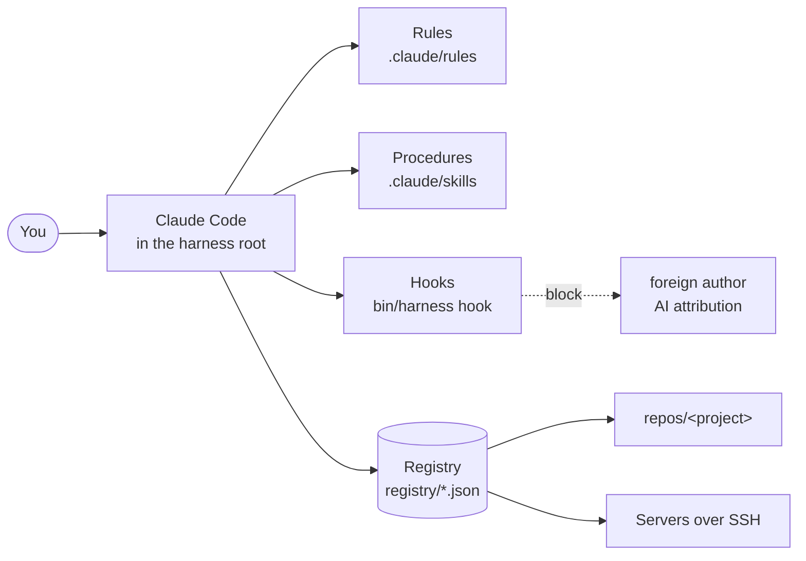

<div align="center">

# harness

**One Claude Code harness for all your projects, servers and habits.**

Rules, procedures and guard hooks that follow you from device to device —
instead of explaining the same things to the agent again in every repository.

[](https://github.com/bukatchuk/harness/releases)
[](https://github.com/bukatchuk/harness/actions/workflows/ci.yml)
[](LICENSE)

[Русский](README.md) · **English**

</div>

```bash
curl -fsSL https://raw.githubusercontent.com/bukatchuk/harness/main/install.sh | bash
```

---

## Why

Once you have more than one project, Claude Code starts from scratch in each of them. In one repository it knows how you commit, in another it does not. On one server it asks before restarting a service, on another it does not. The rules spread over a dozen `CLAUDE.md` files and stop matching.

harness keeps everything in one place. You start `claude` from its directory, and your projects live inside as ordinary clones. In any task the agent sees the same rules, knows all your repositories and servers, and understands which repository configures which server.

## What you get

- **One set of rules for every project.** Git, secrets, servers, Docker, tasks, context economy — seven short files that apply everywhere.
- **Commits in your name, with no trace of AI.** The author is pinned, and a hook blocks `Co-Authored-By`, "Generated with …" and attempts to swap the author — in the command, in a message file, in a PR or release description.
- **A registry of projects, servers and hosting resources.** The agent knows what is deployed where, where it is configured from and which bucket the backups go to: `bin/harness map <server>` answers with one table.
- **Nothing destructive without your "yes".** Pushes, changes on servers, resource deletion, a registry reset — only after a confirmation that lists the specific actions.
- **14 ready-made procedures.** Commit, push, pull request, adding and removing projects, servers and links, updating, diagnostics, reset, public release.
- **Cleans up after itself.** Everything the agent starts in Docker is labelled and removed with one command; other containers are never touched.
- **Live updates.** A session notices a new version by itself and offers to update without a restart.
- **Two languages.** Rules, procedures and CLI messages come in English and Russian and switch with one command.
- **A thin implementation.** One bash script, the dependencies are `git` and `jq`. Whatever can be checked deterministically is checked by the script, not by a rule in the agent's context.

## Quick start

**1. Install.** The script downloads harness into `~/harness`, checks the dependencies and asks for your name, email and language.

```bash
curl -fsSL https://raw.githubusercontent.com/bukatchuk/harness/main/install.sh | bash
```

<details>
<summary>Without questions, into another directory, or by hand</summary>

```bash
# no questions, your own directory
curl -fsSL https://raw.githubusercontent.com/bukatchuk/harness/main/install.sh \
  | HARNESS_DIR=~/work/harness HARNESS_NAME="First Last" HARNESS_EMAIL=you@example.com HARNESS_LANG=en bash

# by hand
git clone https://github.com/bukatchuk/harness.git ~/harness && cd ~/harness
bin/harness init
```

</details>

**2. Check the environment.**

```bash
cd ~/harness && bin/harness doctor
```

**3. Start Claude Code from the harness root and add your first project.**

```text
$ claude
> /repo-add git@github.com:you/shop.git
> /server-add deploy@shop.example.com
> /service-add shop shop.example.com
> fix the typo on the shop home page, commit and open a PR
```

harness applies only to sessions started from its root: rules, skills and hooks do not reach a session started from another directory.

## How it works



| Path | What it is |
| --- | --- |
| `bin/harness` | the CLI and the hooks: everything that is checked deterministically |
| `i18n/ru`, `i18n/en` | sources of the rules, skills and cheat sheets in two languages |
| `.claude/` | their deployed copy in the chosen language; your own rules and skills go here too |
| `.claude/settings.json` | hooks, permissions, disabled AI attribution |
| `harness.json` | install settings: owner, language, integrations |
| `registry/` | the registry: projects, servers and the links between them — see [Registry](#registry) |
| `repos/` | project clones; each has its own git repository |
| `.githooks/` | git hooks of harness itself: version control |

`harness.json`, `registry/` and `repos/` are your data. They are not part of the harness repository and an update never touches them.

## Registry

The registry is three JSON files in `registry/`. The agent reads them before working with a project or a server and extends them through skills; you do not need to edit them by hand.

| File | What it holds | Main fields |
| --- | --- | --- |
| `repos.json` | projects | `name`, `url`, `branch`, `description`, `stack`, the project in the task tracker |
| `servers.json` | servers | `name`, `host`, `port`, `user`, `env`, `provider`, `location`, `os`, `ipv4`, `ipv6`, `description`, `notes` |
| `services.json` | "repository → server → service" links | `name`, `scope`, `repo`, `path`, `servers`, `runtime`, `deploy`, `url`, `notes` |

A link describes more than an application. Everything the application depends on that is configured outside the server is recorded the same way — for example, an S3 bucket for backups:

```json
{
  "name": "s3-shop-backups",
  "scope": "service",
  "description": "The shop-backups bucket: daily database dumps",
  "repo": "shop",
  "path": "scripts/backup.sh",
  "servers": ["shop-prod"],
  "runtime": "S3 object storage: endpoint https://s3.example.com, region ru-1",
  "deploy": "the bucket and its key are created by hand; settings live in secrets.env on the server",
  "url": null,
  "notes": "The local copy is deleted after the upload"
}
```

The registry holds the bucket name, endpoint and region but no access keys: secrets are never written to the registry.

If a hosting provider is connected (currently Timeweb Cloud), the agent reconciles the registry with its API and adds what cannot be learned from the server itself. A server gets a `timeweb` block: identifier, project, zone, plan, creation date, the address's reverse record (PTR). A bucket link gets the same kind of block with the bucket identifier, project, access type and storage class. This data shows which resources are missing from the registry and which exist at the provider but are used nowhere.

`bin/harness servers` lists the servers; `bin/harness map <name>` shows everything linked to a server, a repository or a service, buckets included.

## Procedures (skills)

Call them in a session with `/name` or just ask: "commit", "open a PR", "take this server out of the registry".

| Command | What it does |
| --- | --- |
| `/commit [project]` | A commit in your name: secret scan, files added by name, a message in the project's style. |
| `/push [project]` | Checks the authorship of outgoing commits and pushes. Respects whether the project takes direct pushes or PRs only. |
| `/pr-create [project] [base]` | A working branch, a commit check, a description built from every commit of the branch, a link to the PR. |
| `/repo-add <git-url>` | Adds a project to the registry, clones it, fills in the description and stack from what is actually there. |
| `/repo-remove <project>` | Takes a project out of the registry; the clone is deleted only by a separate decision and never silently when it holds work. |
| `/repo-sync [project]` | Clones what is missing and updates what exists — a clean tree only, fast-forward only. |
| `/server-add <user@host>` | Verifies the host key fingerprint, checks SSH login, collects facts and writes the server to the registry. |
| `/server-remove <server>` | Takes a server out of the registry and out of the links that reference it. |
| `/service-add <project> <server>` | Records which repository configures which server or service and how changes are delivered. |
| `/service-remove <service>` | Removes a link from the registry. |
| `/harness-doctor` | A full environment check with real requests; a next step for every problem. |
| `/harness-update` | Shows what will change, waits for consent and updates harness in the running session. |
| `/harness-reset` | Returns the registry to its initial state: a plan first, then a confirmation, and a backup before the change. |
| `/release-public` | Builds the open version without your data, scans it for leaks and publishes after a confirmation — or right after every release if `release.auto_publish` is on in `harness.json`. |

## CLI

```text
bin/harness <command>
```

| Command | What it does |
| --- | --- |
| `init` | First-time setup: owner, language, git hooks. Safe to run again. |
| `lang [ru\|en]` | Show or switch the language of rules, skills and messages. |
| `version` | The version and whether an update is available. |
| `doctor [--deep]` | Environment check; `--deep` makes API requests and logs in to the servers. |
| `sync [name]` | Clone and update the projects from the registry. |
| `status` | A table of clones: branch, modified files, distance from upstream. |
| `servers` | A table of servers. |
| `server-check [name]` | SSH login check: key only, no prompts. |
| `map [name]` | Links between repositories, servers and services. |
| `repo-remove`, `server-remove`, `service-remove` | Removal from the registry, with a backup. |
| `reset [--delete-clones] [--yes]` | Empties the registry. Without `--yes` it only prints the plan. |
| `check-commits [path]` | Author, committer and AI attribution in unpushed commits. |
| `docker-up`, `docker-check`, `docker-clean` | Start the daemon and clean up the resources created by harness. |
| `locks`, `unlock <name>` | Clones held by parallel sessions, and removing a lock when the owner says so. |
| `worktree <name> <branch> [--remove]` | A separate working copy of a clone for a session that did not get the clone. |
| `selfcheck` | Integrity of harness itself. |
| `release-build`, `release-publish` | Build and publish the open version. |

## What harness will not let the agent do

| What | How it is enforced |
| --- | --- |
| Swap the commit author | a hook rejects `--author`, `-c user.*`, `git config user.*`, `GIT_AUTHOR_*` |
| Add AI attribution | a hook checks the text of a commit, tag, PR and release — in the command and in a file |
| Commit to harness without a version | git hooks require a `VERSION` bump and an entry in both changelogs |
| Lose unsaved work when a clone is deleted | the command refuses without `--force` and reports the numbers |
| Remove a server that links refer to | the command refuses without `--unlink` |
| Reset the registry by accident | without `--yes` the command prints the plan and changes nothing |
| Publish your data | the release build stops on any email, address, identifier, token or term from your settings |

The rest — pushes, changes on servers, actions in external services, handling of secrets — is set by the rules: the agent asks for confirmation and names what exactly the action affects. The rules are short and worth reading: [`i18n/en/rules`](i18n/en/rules).

## Settings

`harness.json` is created by `bin/harness init`. An integration is enabled once its key appears.

```json
{
  "owner": { "name": "First Last", "email": "you@example.com" },
  "lang": "en",
  "integrations": {
    "plane": { "url": "https://plane.example.com", "workspace": "team", "default_project": "MAIN", "default_project_id": "<id>" },
    "n8n": { "url": "https://n8n.example.com" },
    "gitguardian": {},
    "mailcow": { "url": "https://mail.example.com" },
    "yandex_cloud": {},
    "timeweb": {}
  }
}
```

| Integration | What it gives | Access |
| --- | --- | --- |
| Plane | tasks: the agent keeps statuses current and writes closing comments | `PLANE_TOKEN` |
| n8n | reading workflows and executions; changes after a confirmation | `N8N_TOKEN` |
| GitGuardian | secret scanning before every commit and in the release build | `GITGUARDIAN_TOKEN` |
| Yandex Cloud | reading resources; changes after a confirmation | the `yc` profile |
| mailcow | reading domains, mailboxes and aliases; changes after a confirmation | `MAILCOW_TOKEN` |
| Timeweb Cloud | reading servers, S3 buckets and addresses; creating and deleting only on an explicit instruction | `TW_TOKEN` |

Tokens live in environment variables only. harness checks that they are present but never reads or prints their values.

## Requirements

- [Claude Code](https://claude.com/claude-code)
- `git`, `jq`, `curl`, `bash` 3.2 or newer (the stock macOS bash is fine)
- optional: `gh` for PRs and releases, `docker` for local tests, `ssh` with a key for servers

## Updating

Every 15 minutes a session checks whether a new version is out and offers to update — nothing changes without your consent. By hand: `/harness-update` in a session, or `git pull --ff-only && bin/harness lang` in a terminal.

Every version is a tag, an entry in [CHANGELOG.en.md](CHANGELOG.en.md) and a release with an archive.

You can get a Telegram message about every release: add the `TELEGRAM_BOT_TOKEN` and `TELEGRAM_CHAT_ID` secrets in the repository settings on GitHub (Settings → Secrets and variables → Actions). The message is sent by [release-notify.yml](.github/workflows/release-notify.yml); without the secrets it does nothing.

## FAQ

**How is this different from a `CLAUDE.md` in every project?**
The project's `CLAUDE.md` stays and refines the harness rules. harness covers what is common: how you commit, what you treat as a secret, what may be done on servers. On authorship, secrets and Docker cleanup the harness rules win.

**Will my projects and servers end up in someone's repository?**
No. `harness.json`, `registry/` and `repos/` are excluded from git. To carry them between devices, keep these files in your own private repository or a dotfiles manager.

**Can I add my own rules and procedures?**
Yes: put a file into `.claude/rules/` or a directory into `.claude/skills/`. A language switch or an update does not touch them.

**I do not use Plane, n8n, Yandex Cloud or Timeweb Cloud.**
Nothing to do: integrations stay off until they appear in `harness.json`.

**How do I get the registry back after a reset?**
Copy the files from `.harness-backup/<timestamp>/` into `registry/` and run `bin/harness sync`.

## Contributing

Ideas and fixes are welcome — see [CONTRIBUTING.md](CONTRIBUTING.md). The main question for any addition: could a script or a hook solve it instead of a rule? Vulnerabilities — [SECURITY.md](SECURITY.md).

## License

[MIT](LICENSE) © Oleg Bukatchuk
