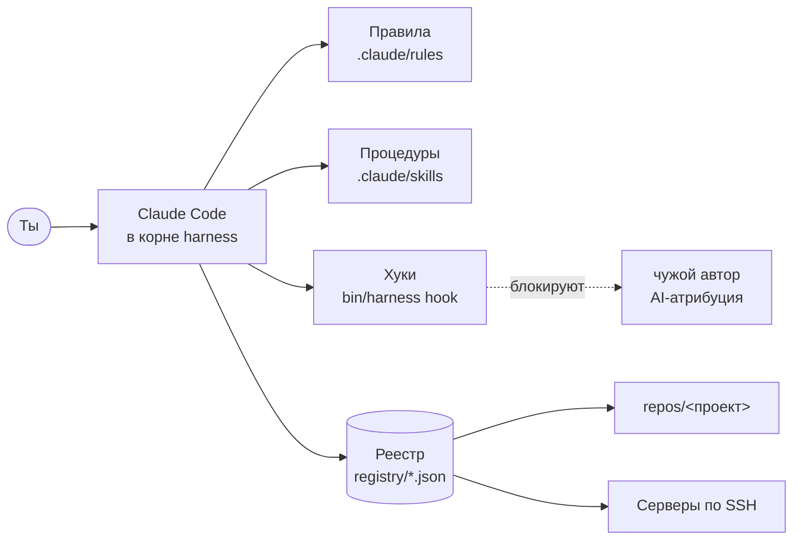

<div align="center">

# harness

**Одна обвязка Claude Code для всех твоих проектов, серверов и привычек.**

Правила, процедуры и защитные хуки, которые едут за тобой с устройства на устройство —
вместо того чтобы заново объяснять агенту одно и то же в каждом репозитории.

[](https://github.com/bukatchuk/harness/releases)
[](https://github.com/bukatchuk/harness/actions/workflows/ci.yml)
[](LICENSE)

**Русский** · [English](README.en.md)

</div>

```bash
curl -fsSL https://raw.githubusercontent.com/bukatchuk/harness/main/install.sh | bash
```

---

## Зачем это нужно

Когда проектов больше одного, Claude Code в каждом из них начинает с нуля. В одном репозитории он знает, как у тебя принято коммитить, в другом — нет. На одном сервере он спросит, прежде чем перезапустить сервис, на другом — не спросит. Правила расползаются по десятку `CLAUDE.md` и перестают совпадать.

harness собирает всё в одном месте. Ты запускаешь `claude` из его каталога, а проекты лежат внутри как обычные клоны. Агент в любой задаче видит одни и те же правила, знает все твои репозитории и серверы и понимает, какой репозиторий какой сервер настраивает.

## Что ты получаешь

- **Единые правила для всех проектов.** Git, секреты, серверы, Docker, задачи, экономия контекста — семь коротких файлов, которые действуют везде.
- **Коммиты от твоего имени, без следов AI.** Автор закреплён, а хук блокирует `Co-Authored-By`, «Generated with …» и попытки подменить автора — в команде, в файле с текстом, в описании PR и релиза.
- **Реестр проектов и серверов.** Агент знает, что где развёрнуто и откуда настраивается: `bin/harness map <сервер>` отвечает одной таблицей.
- **Ничего разрушительного без твоего «да».** Push, изменения на серверах, удаление ресурсов, сброс реестра — только после подтверждения с перечнем конкретных действий.
- **14 готовых процедур.** Коммит, push, pull request, добавление и удаление проектов, серверов и связей, обновление, диагностика, сброс, публичный релиз.
- **Уборка за собой.** Всё, что агент запускает в Docker, помечается и удаляется одной командой; чужие контейнеры не трогаются.
- **Обновление на лету.** Сессия сама замечает новую версию и предлагает обновиться без перезапуска.
- **Два языка.** Правила, процедуры и сообщения CLI — на русском и английском, переключаются одной командой.
- **Тонкая реализация.** Один bash-скрипт, зависимости — `git` и `jq`. Всё, что можно проверить детерминированно, проверяет скрипт, а не правило в контексте агента.

## Быстрый старт

**1. Установи.** Скрипт скачает harness в `~/harness`, проверит зависимости и спросит имя, почту и язык.

```bash
curl -fsSL https://raw.githubusercontent.com/bukatchuk/harness/main/install.sh | bash
```

<details>
<summary>Без вопросов, в другой каталог или вручную</summary>

```bash
# без вопросов и в свой каталог
curl -fsSL https://raw.githubusercontent.com/bukatchuk/harness/main/install.sh \
  | HARNESS_DIR=~/work/harness HARNESS_NAME="Имя Фамилия" HARNESS_EMAIL=you@example.com HARNESS_LANG=ru bash

# вручную
git clone https://github.com/bukatchuk/harness.git ~/harness && cd ~/harness
bin/harness init
```

</details>

**2. Проверь окружение.**

```bash
cd ~/harness && bin/harness doctor
```

**3. Запусти Claude Code из корня harness и добавь первый проект.**

```text
$ claude
> /repo-add git@github.com:you/shop.git
> /server-add deploy@shop.example.com
> /service-add shop shop.example.com
> исправь опечатку на главной в shop, закоммить и открой PR
```

harness действует только в сессиях, запущенных из его корня: правила, skills и хуки в сессию из другого каталога не попадают.

## Как это устроено



| Путь | Что это |
| --- | --- |
| `bin/harness` | CLI и хуки: всё, что проверяется детерминированно |
| `i18n/ru`, `i18n/en` | исходники правил, skills и шпаргалок на двух языках |
| `.claude/` | их развёрнутая копия на выбранном языке; сюда же можно класть свои правила и skills |
| `.claude/settings.json` | хуки, разрешения, отключённая AI-атрибуция |
| `harness.json` | настройки установки: владелец, язык, интеграции |
| `registry/` | реестр: проекты, серверы и связи между ними |
| `repos/` | клоны проектов; у каждого свой git-репозиторий |
| `.githooks/` | git-хуки самого harness: контроль версии |

`harness.json`, `registry/` и `repos/` — твои данные. В репозиторий harness они не входят и при обновлении не затрагиваются.

## Процедуры (skills)

Вызываются в сессии через `/имя` или обычной просьбой: «закоммить», «открой PR», «убери этот сервер из реестра».

| Команда | Что делает |
| --- | --- |
| `/commit [проект]` | Коммит от твоего имени: проверка на секреты, файлы поимённо, сообщение в стиле проекта. |
| `/push [проект]` | Проверяет авторство исходящих коммитов и отправляет. Учитывает, принят ли в проекте прямой push или только PR. |
| `/pr-create [проект] [база]` | Рабочая ветка, проверка коммитов, описание по всем коммитам ветки, ссылка на PR. |
| `/repo-add <git-url>` | Добавляет проект в реестр, клонирует, заполняет описание и стек по факту. |
| `/repo-remove <проект>` | Убирает проект из реестра; клон удаляется только по отдельному решению и не молча, если в нём есть работа. |
| `/repo-sync [проект]` | Клонирует недостающее и обновляет существующее — только чистое дерево и только fast-forward. |
| `/server-add <user@host>` | Сверяет отпечаток ключа хоста, проверяет вход по SSH, собирает сведения и записывает сервер в реестр. |
| `/server-remove <сервер>` | Убирает сервер из реестра и из связей, которые на него ссылаются. |
| `/service-add <проект> <сервер>` | Записывает, какой репозиторий настраивает какой сервер или сервис и как доставляются изменения. |
| `/service-remove <сервис>` | Удаляет связь из реестра. |
| `/harness-doctor` | Полная проверка окружения с реальными запросами; по каждой проблеме — следующий шаг. |
| `/harness-update` | Показывает, что изменится, ждёт согласия и обновляет harness в работающей сессии. |
| `/harness-reset` | Возвращает реестр в исходное состояние: сначала план, потом подтверждение, перед изменением — резервная копия. |
| `/release-public` | Собирает открытую версию без твоих данных, проверяет на утечки и публикует после подтверждения. |

## CLI

```text
bin/harness <команда>
```

| Команда | Что делает |
| --- | --- |
| `init` | Первичная настройка: владелец, язык, git-хуки. Можно запускать повторно. |
| `lang [ru\|en]` | Показать или сменить язык правил, skills и сообщений. |
| `version` | Версия и наличие обновления. |
| `doctor [--deep]` | Проверка окружения; `--deep` — с запросами к API и входом на серверы. |
| `sync [имя]` | Клонировать и обновить проекты из реестра. |
| `status` | Таблица клонов: ветка, изменённые файлы, расхождение с upstream. |
| `servers` | Таблица серверов. |
| `server-check [имя]` | Проверка входа по SSH: только по ключу, без вопросов. |
| `map [имя]` | Связи между репозиториями, серверами и сервисами. |
| `repo-remove`, `server-remove`, `service-remove` | Удаление из реестра с резервной копией. |
| `reset [--delete-clones] [--yes]` | Очистка реестра. Без `--yes` только показывает план. |
| `check-commits [путь]` | Автор, коммиттер и AI-атрибуция в неотправленных коммитах. |
| `docker-up`, `docker-check`, `docker-clean` | Запуск демона и уборка ресурсов, созданных harness. |
| `selfcheck` | Целостность самого harness. |
| `release-build`, `release-publish` | Сборка и публикация открытой версии. |

## Что harness не даст сделать агенту

| Что | Как обеспечено |
| --- | --- |
| Подменить автора коммита | хук отклоняет `--author`, `-c user.*`, `git config user.*`, `GIT_AUTHOR_*` |
| Добавить AI-атрибуцию | хук проверяет текст коммита, тега, PR и релиза — в команде и в файле |
| Закоммитить в harness без версии | git-хуки требуют подъёма `VERSION` и записи в обоих журналах |
| Потерять несохранённую работу при удалении клона | команда отказывается без `--force` и называет числа |
| Удалить сервер, на который ссылаются связи | команда отказывается без `--unlink` |
| Сбросить реестр случайно | без `--yes` команда печатает план и ничего не меняет |
| Опубликовать твои данные | сборка релиза останавливается на любой почте, адресе, идентификаторе, токене и слове из твоих настроек |

Остальное — push, изменения на серверах, действия во внешних сервисах, обращение с секретами — задано правилами: агент спрашивает подтверждение и называет, что именно затронет действие. Правила короткие, их стоит прочитать: [`i18n/ru/rules`](i18n/ru/rules).

## Настройки

`harness.json` создаёт `bin/harness init`. Интеграция включается, когда появляется её ключ.

```json
{
  "owner": { "name": "Имя Фамилия", "email": "you@example.com" },
  "lang": "ru",
  "integrations": {
    "plane": { "url": "https://plane.example.com", "workspace": "team", "default_project": "MAIN", "default_project_id": "<id>" },
    "n8n": { "url": "https://n8n.example.com" },
    "gitguardian": {},
    "yandex_cloud": {}
  }
}
```

| Интеграция | Что даёт | Доступ |
| --- | --- | --- |
| Plane | задачи: агент сам ведёт статусы и пишет итоговые комментарии | `PLANE_TOKEN` |
| n8n | чтение workflow и запусков; изменения — после подтверждения | `N8N_TOKEN` |
| GitGuardian | поиск секретов перед каждым коммитом и в сборке релиза | `GITGUARDIAN_TOKEN` |
| Yandex Cloud | чтение ресурсов; изменения — после подтверждения | профиль `yc` |

Токены живут только в переменных окружения. harness проверяет их наличие, но никогда не читает и не выводит значения.

## Требования

- [Claude Code](https://claude.com/claude-code)
- `git`, `jq`, `curl`, `bash` 3.2 или новее (подходит штатный bash в macOS)
- по желанию: `gh` — для PR и релизов, `docker` — для локальных тестов, `ssh` с ключом — для серверов

## Обновление

Раз в 15 минут сессия проверяет, не вышла ли новая версия, и предлагает обновиться — без твоего согласия ничего не меняется. Вручную: `/harness-update` в сессии или `git pull --ff-only && bin/harness lang` в терминале.

Каждая версия — это тег, запись в [CHANGELOG.md](CHANGELOG.md) и релиз с архивом.

## Вопросы

**Чем это отличается от `CLAUDE.md` в каждом проекте?**
Проектный `CLAUDE.md` остаётся и уточняет правила harness. harness отвечает за общее: как ты коммитишь, что считаешь секретом, что можно делать на серверах. В вопросах авторства, секретов и уборки Docker действуют правила harness.

**Мои проекты и серверы попадут в чей-то репозиторий?**
Нет. `harness.json`, `registry/` и `repos/` исключены из git. Чтобы переносить их между устройствами, храни эти файлы в своём приватном репозитории или в менеджере dotfiles.

**Можно добавить свои правила и процедуры?**
Да: положи файл в `.claude/rules/` или каталог в `.claude/skills/`. Смена языка и обновление их не трогают.

**Я не пользуюсь Plane, n8n или Yandex Cloud.**
Ничего делать не нужно: интеграции выключены, пока их нет в `harness.json`.

**Как вернуть реестр после сброса?**
Скопируй файлы из `.harness-backup/<дата-время>/` в `registry/` и выполни `bin/harness sync`.

## Участие

Идеи и исправления приветствуются — см. [CONTRIBUTING.md](CONTRIBUTING.md). Главный вопрос к любому добавлению: нельзя ли решить это скриптом или хуком вместо правила. Об уязвимостях — [SECURITY.md](SECURITY.md).

## Лицензия

[MIT](LICENSE) © Oleg Bukatchuk
